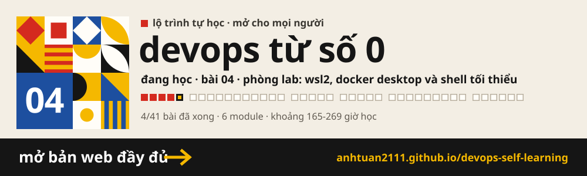

# DevOps lang băm

Tự học, không bằng cấp, không chứng chỉ, nhưng học tới bản chất để làm được việc của một junior DevOps hay SRE.

68 bài, 10 module. Mỗi bài đọc riêng được; bài nào cần biết trước khái niệm gì thì ghi ở cột "Cần biết".
Cột "Thực hành" cho biết lab chạy ở đâu: máy bạn, server, cloud, GitLab, cụm Kubernetes, hoặc chỉ đọc.

## Mục lục

### M0 · Phía sau một cú bấm

Một cú bấm trên trình duyệt đi qua những tầng nào trước khi tới server.

| # | Bài | Cần biết | Thực hành | Trạng thái |
|---|---|---|---|---|
| `00` | [Bấm like trên facebook.com: bảy tầng OSI](https://anhtuan2111.github.io/devops-self-learning/lessons/00-osi-layers/) | không | máy bạn | đang học |
| `01` | TCP/IP: Internet chạy thế nào | bảy tầng OSI | máy bạn | chưa học |
| `02` | Người làm DevOps nắm chỗ nào trong các tầng | TCP/IP, DNS, HTTP | chỉ đọc | chưa học |

### M1 · Một cái máy Linux

Server gần như luôn là một máy Linux, nên học một máy trước rồi mới tới nhiều máy.

| # | Bài | Cần biết | Thực hành | Trạng thái |
|---|---|---|---|---|
| `03` | Server là cái gì: phần cứng, hệ điều hành, process | không | máy bạn | chưa học |
| `04` | Phòng lab: Linux trên máy Windows | process, kernel | máy bạn | chưa học |
| `05` | File, user, quyền | process, shell | máy bạn | chưa học |
| `06` | Process, signal, service, log | process, user và quyền | máy bạn | chưa học |
| `07` | Shell script | shell, lệnh Linux cơ bản | máy bạn | chưa học |
| `08` | Mạng trên một máy: listen, port, firewall | IP, TCP, process | máy bạn | chưa học |
| `09` | Server chậm: CPU, RAM, đĩa, mạng | process, kernel, CPU, RAM | máy bạn | chưa học |
| `10` | Chẩn đoán theo tầng | đường đi của request trên server, listen và port, HTTP | máy bạn | chưa học |

### M2 · Server thật, làm bằng tay

Đưa app lên một server bằng tay, từng bước một.

| # | Bài | Cần biết | Thực hành | Trạng thái |
|---|---|---|---|---|
| `11` | Kiếm một server để thực hành | Linux, user và quyền | server | chưa học |
| `12` | SSH: điều khiển một máy ở xa | IP, port, user, shell | server | chưa học |
| `13` | Deploy tay | SSH, service, biến môi trường | server | chưa học |
| `14` | Nginx | listen và port, HTTP | server | chưa học |
| `15` | Tên miền và HTTPS | DNS, TLS, reverse proxy | server | chưa học |
| `16` | Hai server sau một load balancer | Nginx, deploy tay | server | chưa học |
| `17` | Server để yên ba tháng | service, log, chứng chỉ, shell script | server | chưa học |

### M3 · Container

Đóng app cùng mọi thứ nó cần thành một khối, chạy ở máy nào cũng giống nhau.

| # | Bài | Cần biết | Thực hành | Trạng thái |
|---|---|---|---|---|
| `18` | Container là gì | process, kernel, cài một app lên server | máy bạn | chưa học |
| `19` | Image và container | container | máy bạn | chưa học |
| `20` | Dockerfile | image, container | máy bạn | chưa học |
| `21` | Network và volume | image, container, IP và port, DNS | máy bạn | chưa học |
| `22` | Cấu hình, secret và Compose | Dockerfile, network, volume | máy bạn | chưa học |
| `23` | Cache và message queue | Compose, database | máy bạn | chưa học |
| `24` | Registry và image để chạy production | Dockerfile, Compose | server | chưa học |
| `25` | Dựng lại cả hệ thống bằng container | Dockerfile, Compose, registry, Nginx | server | chưa học |

### M4 · Git và CI/CD với GitLab

Các bước build, đẩy image, deploy giao cho pipeline làm.

| # | Bài | Cần biết | Thực hành | Trạng thái |
|---|---|---|---|---|
| `26` | Git cho người vận hành | không | máy bạn | chưa học |
| `27` | Pipeline đầu tiên | Git, image, registry | GitLab | chưa học |
| `28` | Build, test, đóng image trong pipeline | pipeline, Dockerfile | GitLab | chưa học |
| `29` | Deploy tự động, môi trường, rollback | pipeline, registry, deploy tay | server | chưa học |
| `30` | Migration database trong pipeline | pipeline, deploy tự động, database | server | chưa học |
| `31` | Secret và an toàn của pipeline | pipeline, image | GitLab | chưa học |

### M5 · Hạ tầng bằng code và cloud

Server, mạng, bản ghi DNS cũng viết thành code để dựng lại được.

| # | Bài | Cần biết | Thực hành | Trạng thái |
|---|---|---|---|---|
| `32` | Hạ tầng là code | deploy tay, Git | chỉ đọc | chưa học |
| `33` | Ansible | SSH, Linux, shell script | máy bạn | chưa học |
| `34` | Cloud tối thiểu và IAM | server, IP, load balancer | cloud | chưa học |
| `35` | Mạng trên cloud: VPC, subnet, NAT, VPN | IP, mạng riêng, router, firewall | cloud | chưa học |
| `36` | Terraform | cloud, VPC | cloud | chưa học |

### M6 · Kubernetes

Quản container trên nhiều máy.

| # | Bài | Cần biết | Thực hành | Trạng thái |
|---|---|---|---|---|
| `37` | Vì sao cần Kubernetes | container, Compose, load balancer | chỉ đọc | chưa học |
| `38` | Cụm đầu tiên và Pod | container, YAML | cụm Kubernetes | chưa học |
| `39` | Deployment | Pod | cụm Kubernetes | chưa học |
| `40` | Service và DNS trong cụm | Pod, DNS, IP và port | cụm Kubernetes | chưa học |
| `41` | Ingress | Service, reverse proxy, HTTPS | cụm Kubernetes | chưa học |
| `42` | ConfigMap và Secret | Pod, Deployment, biến môi trường | cụm Kubernetes | chưa học |
| `43` | Lưu trữ: PersistentVolume và StatefulSet | Pod, Deployment, volume | cụm Kubernetes | chưa học |
| `44` | Tài nguyên và probe | Pod, Deployment, OOM killer | cụm Kubernetes | chưa học |
| `45` | Helm | Deployment, Service, Ingress, ConfigMap | cụm Kubernetes | chưa học |
| `46` | Namespace, RBAC, NetworkPolicy | Pod, Service | cụm Kubernetes | chưa học |
| `47` | Controller, CRD và operator | Deployment, StatefulSet | cụm Kubernetes | chưa học |
| `48` | Dựng lại cả hệ thống trên cụm | Helm, Ingress, StatefulSet, probe | cụm Kubernetes | chưa học |

### M7 · Quan sát hệ thống

Biết hệ thống đang chạy ra sao mà không phải đợi người dùng báo.

| # | Bài | Cần biết | Thực hành | Trạng thái |
|---|---|---|---|---|
| `49` | Metric: Prometheus và Grafana | process, HTTP, Kubernetes | cụm Kubernetes | chưa học |
| `50` | Log tập trung | log, Pod | cụm Kubernetes | chưa học |
| `51` | Trace | metric, log, HTTP | cụm Kubernetes | chưa học |
| `52` | eBPF | kernel, syscall, trace | chỉ đọc | chưa học |

### M8 · Nền tảng

Nhiều cụm, nhiều team dùng chung.

| # | Bài | Cần biết | Thực hành | Trạng thái |
|---|---|---|---|---|
| `53` | GitOps với Argo CD | Kubernetes, Helm, Git | cụm Kubernetes | chưa học |
| `54` | Rancher: quản nhiều cụm | Kubernetes, RBAC, namespace | cụm Kubernetes | chưa học |
| `55` | OpenShift | Kubernetes, Ingress, RBAC | cụm Kubernetes | chưa học |
| `56` | Secret tập trung | Secret, GitOps | cụm Kubernetes | chưa học |
| `57` | Bảo mật cụm: policy và audit | RBAC, Pod, image | cụm Kubernetes | chưa học |
| `58` | Service mesh | Service, Ingress, TLS, trace | cụm Kubernetes | chưa học |
| `59` | Nền tảng tự phục vụ | Dockerfile, pipeline, Helm, GitOps | cụm Kubernetes | chưa học |

### M9 · SRE: giữ hệ thống chạy

Đặt mức chạy tốt, báo khi lệch, xử lý khi hỏng, và chuẩn bị cho lúc mất hết.

| # | Bài | Cần biết | Thực hành | Trạng thái |
|---|---|---|---|---|
| `60` | SLI, SLO, error budget | metric | cụm Kubernetes | chưa học |
| `61` | Cảnh báo và trực sự cố | metric, SLO | cụm Kubernetes | chưa học |
| `62` | Xử lý sự cố và postmortem | chẩn đoán theo tầng, metric, log, cảnh báo | cụm Kubernetes | chưa học |
| `63` | Database khi chạy production | database, volume | server | chưa học |
| `64` | Backup và khôi phục | database, PersistentVolume, Kubernetes | cụm Kubernetes | chưa học |
| `65` | Chạy ở nhiều vùng | DNS, load balancer, replication, backup | chỉ đọc | chưa học |
| `66` | Chi phí | cloud, requests và limits | chỉ đọc | chưa học |
| `67` | Tổng kết: dựng lại từ repo trống | container, Kubernetes, pipeline, GitOps, metric, Terraform | cụm Kubernetes | chưa học |
