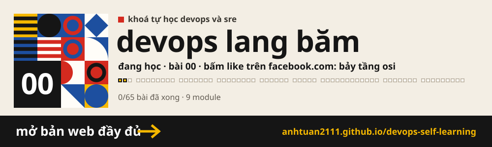

# DevOps lang băm

Khoá tự học DevOps bằng tiếng Việt, viết cho người đã làm được app Java, Spring Boot nhưng chưa làm việc với server, mạng,
container hay Kubernetes. Khoá đi từ đường đi của một request trên Internet tới lúc đưa app lên cụm Kubernetes và theo dõi app
khi nó đã chạy. Mình viết khoá này trong lúc tự học, học tới đâu viết tới đó, nên phần lớn bài trong mục lục dưới đây mới có
tên, chưa có nội dung. "Lang băm" là cách mình gọi đùa, vì khoá không cấp bằng hay chứng chỉ nào.

Bản web của khoá nằm ở https://anhtuan2111.github.io/devops-self-learning/.

## Cách đọc mục lục

Mục lục có 65 bài, chia thành 9 module. Người mới nên đọc từ Bài 00. Bài nào cũng đọc riêng được
nếu bạn đã biết các khái niệm ghi ở cột "Cần biết" của bài đó; bài ghi "không" thì đọc được ngay.

Bài đã viết thì tên bài có link sang bản web.

Cột "Lab" cho biết phần thực hành của bài làm ở đâu:

- "máy bạn": làm ngay trên máy của bạn.
- "server": cần một server để thực hành; Bài 11 hướng dẫn cách kiếm một server.
- "cloud": cần một tài khoản ở một hãng cloud, tức nơi cho thuê máy theo giờ.
- "GitLab": cần một tài khoản GitLab để lưu code và chạy các bước build, deploy tự động.
- "cụm Kubernetes": cần một cụm Kubernetes; cụm để thực hành dựng được ngay trên máy của bạn.
- "chỉ đọc": bài không có phần thực hành.

## Mục lục

### M0 · Phía sau một cú bấm

| Số | Bài | Cần biết | Lab |
|---|---|---|---|
| `00` | [Bấm like trên facebook.com: bảy tầng OSI](https://anhtuan2111.github.io/devops-self-learning/lessons/00-osi-layers/) | không | máy bạn |
| `01` | [TCP/IP: Internet chạy thế nào](https://anhtuan2111.github.io/devops-self-learning/lessons/01-tcp-ip/) | bảy tầng OSI | máy bạn |
| `02` | [Người làm DevOps nắm chỗ nào trong các tầng](https://anhtuan2111.github.io/devops-self-learning/lessons/02-where-devops-fits/) | TCP/IP, DNS, HTTP | chỉ đọc |

### M1 · Một cái máy Linux

| Số | Bài | Cần biết | Lab |
|---|---|---|---|
| `03` | [Server là cái gì: phần cứng, hệ điều hành, process](https://anhtuan2111.github.io/devops-self-learning/lessons/03-what-is-a-server/) | không | máy bạn |
| `04` | [Phòng lab: Linux trên máy Windows](https://anhtuan2111.github.io/devops-self-learning/lessons/04-linux-lab/) | process, kernel | máy bạn |
| `05` | File, user, quyền | process, shell | máy bạn |
| `06` | Process, signal, service, log | process, user và quyền | máy bạn |
| `07` | Shell script | shell, lệnh Linux cơ bản | máy bạn |
| `08` | Mạng trên một máy: listen, port, firewall | IP, TCP, process | máy bạn |
| `09` | Server chậm: CPU, RAM, đĩa, mạng | process, kernel, CPU, RAM | máy bạn |
| `10` | Chẩn đoán theo tầng | đường đi của request trên server, listen và port, HTTP | máy bạn |

### M2 · Server thật, làm bằng tay

| Số | Bài | Cần biết | Lab |
|---|---|---|---|
| `11` | Kiếm một server để thực hành | Linux, user và quyền | server |
| `12` | SSH: điều khiển một máy ở xa | IP, port, user, shell | server |
| `13` | Deploy tay | SSH, service | server |
| `14` | Nginx | listen và port, HTTP | server |
| `15` | Tên miền và HTTPS | DNS, TLS, reverse proxy | server |
| `16` | Hai server sau một load balancer | Nginx, deploy tay | server |
| `17` | Server để yên ba tháng | service, log, chứng chỉ, shell script | server |

### M3 · Container

| Số | Bài | Cần biết | Lab |
|---|---|---|---|
| `18` | Container là gì | process, kernel, cài một app lên server | máy bạn |
| `19` | Image và container | container | máy bạn |
| `20` | Dockerfile | image, container | máy bạn |
| `21` | Network và volume | image, container, IP và port, DNS | máy bạn |
| `22` | Cấu hình, secret và Compose | Dockerfile, network, volume | máy bạn |
| `23` | Cache và message queue | Compose, database | máy bạn |
| `24` | Registry và image để chạy production | Dockerfile, Compose | server |
| `25` | Dựng lại cả hệ thống bằng container | Dockerfile, Compose, registry, Nginx | server |

### M4 · Git và CI/CD với GitLab

| Số | Bài | Cần biết | Lab |
|---|---|---|---|
| `26` | Git cho người vận hành | không | máy bạn |
| `27` | Pipeline đầu tiên | Git, image, registry | GitLab |
| `28` | Build, test và đóng gói image trong pipeline | pipeline, Dockerfile | GitLab |
| `29` | Deploy tự động, môi trường, rollback | pipeline, registry, deploy tay | server |
| `30` | Migration database trong pipeline | pipeline, deploy tự động, database | server |
| `31` | Secret và an toàn của pipeline | pipeline, image | GitLab |

### M5 · Hạ tầng bằng code và cloud

| Số | Bài | Cần biết | Lab |
|---|---|---|---|
| `32` | Hạ tầng là code | deploy tay, Git | chỉ đọc |
| `33` | Ansible | SSH, Linux, shell script | máy bạn |
| `34` | Cloud tối thiểu và IAM | server, IP, load balancer | cloud |
| `35` | Mạng trên cloud: VPC, subnet, NAT, VPN | IP, mạng riêng, router, firewall | cloud |
| `36` | Terraform | cloud, VPC | cloud |

### M6 · Kubernetes

| Số | Bài | Cần biết | Lab |
|---|---|---|---|
| `37` | Vì sao cần Kubernetes | container, Compose, load balancer | chỉ đọc |
| `38` | Cụm đầu tiên và Pod | container, YAML | cụm Kubernetes |
| `39` | Deployment | Pod | cụm Kubernetes |
| `40` | Service và DNS trong cụm | Pod, DNS, IP và port | cụm Kubernetes |
| `41` | Ingress | Service, reverse proxy, HTTPS | cụm Kubernetes |
| `42` | ConfigMap và Secret | Pod, Deployment, biến môi trường | cụm Kubernetes |
| `43` | Lưu trữ: PersistentVolume và StatefulSet | Pod, Deployment, volume | cụm Kubernetes |
| `44` | Tài nguyên và probe | Pod, Deployment, OOM killer | cụm Kubernetes |
| `45` | Helm | Deployment, Service, Ingress, ConfigMap | cụm Kubernetes |
| `46` | Namespace, RBAC, NetworkPolicy | Pod, Service | cụm Kubernetes |
| `47` | Controller, CRD và operator | Deployment, StatefulSet | cụm Kubernetes |
| `48` | Dựng lại cả hệ thống trên cụm | Helm, Ingress, StatefulSet, probe, Pod, Service, Secret, image | cụm Kubernetes |

### M7 · Nền tảng

| Số | Bài | Cần biết | Lab |
|---|---|---|---|
| `49` | GitOps với Argo CD | Kubernetes, Helm, Git | cụm Kubernetes |
| `50` | Rancher: quản lý nhiều cụm | Kubernetes, RBAC, namespace | cụm Kubernetes |
| `51` | OpenShift | Kubernetes, Ingress, RBAC | cụm Kubernetes |
| `52` | Secret tập trung | Secret, GitOps | cụm Kubernetes |
| `53` | Bảo mật cụm: policy và audit | RBAC, Pod, image | cụm Kubernetes |
| `54` | Service mesh | Service, Ingress, TLS, Pod | cụm Kubernetes |
| `55` | Nền tảng tự phục vụ | Dockerfile, pipeline, Helm, GitOps | cụm Kubernetes |

### M8 · Vận hành và giám sát

| Số | Bài | Cần biết | Lab |
|---|---|---|---|
| `56` | Metric: Prometheus và Grafana | process, HTTP, Kubernetes | cụm Kubernetes |
| `57` | Log tập trung | log, Pod | cụm Kubernetes |
| `58` | Trace | metric, log, HTTP | cụm Kubernetes |
| `59` | eBPF | kernel, syscall, trace | chỉ đọc |
| `60` | Cảnh báo và trực sự cố | metric, log | cụm Kubernetes |
| `61` | Xử lý sự cố và postmortem | chẩn đoán theo tầng, metric, log, cảnh báo | cụm Kubernetes |
| `62` | Database khi chạy production | database, volume | server |
| `63` | Backup và khôi phục | database, PersistentVolume, Kubernetes | cụm Kubernetes |
| `64` | Tổng kết: dựng lại từ repo trống | container, Kubernetes, pipeline, GitOps, metric, Terraform | cụm Kubernetes |
